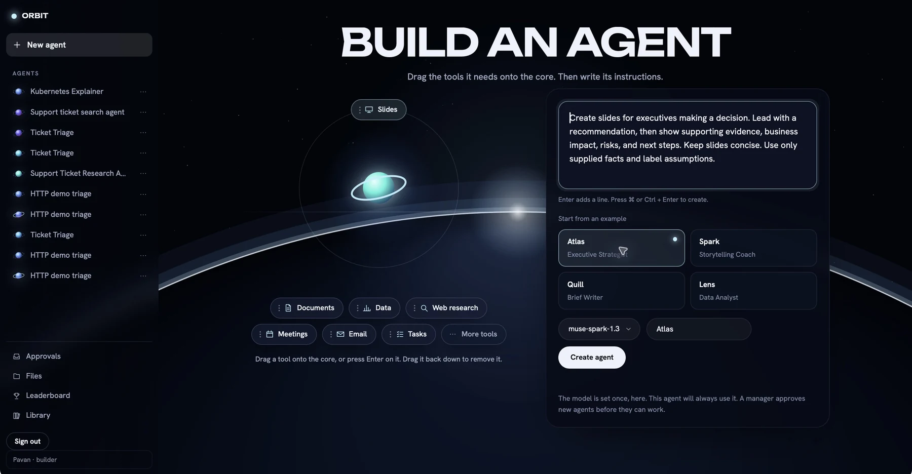
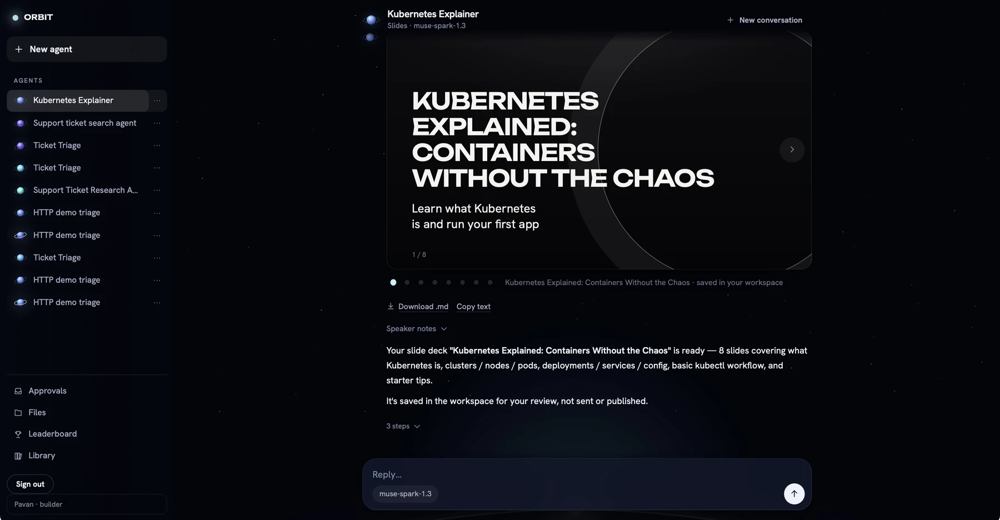
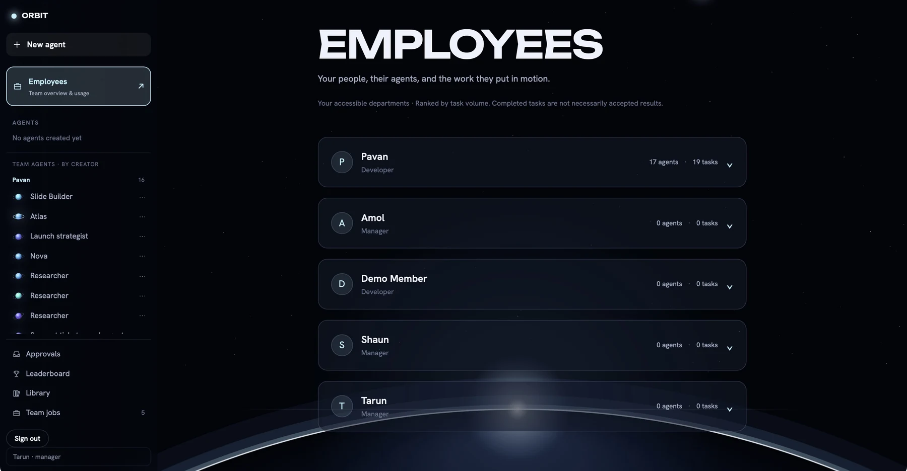
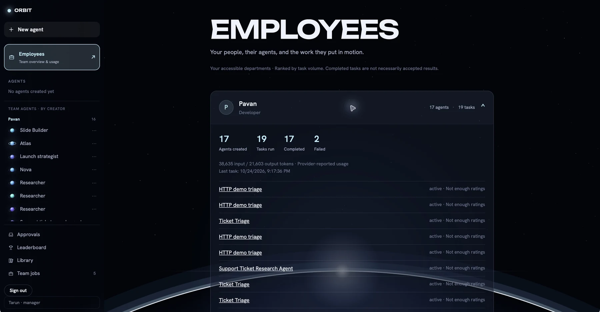
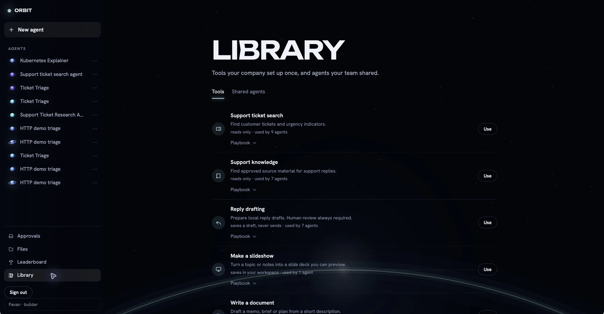
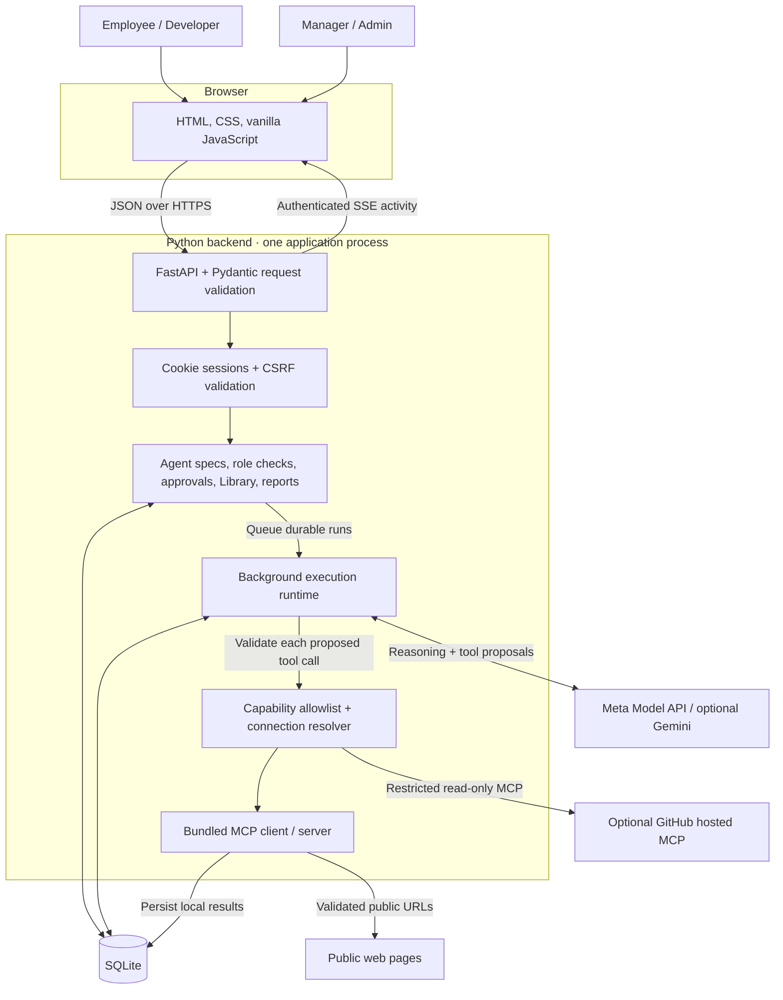

# ORBIT

**AI agents with a job, a manager, and a clear set of permissions.**

Built at HackTX by Amol, Tarun, Shaun, and Pavan. Orbit gives employees a workspace to build specialized agents, while managers approve their scope and see who created them, how they perform, and how the team uses them.

Employees choose capabilities and a playbook, name their agent, and select its model. Managers confirm new agents before they work. Agents create deliverables inside the workspace, and teams can reuse capabilities and agent templates through the company Library.

## Product tour

### Build an agent for a specific job

Choose tools such as slides, documents, data analysis, public web research, meeting invites, email drafts, and task planning. Personas provide reusable instructions. The chosen model stays fixed for that agent.



### Inspect the work, not just the answer

Conversations retain generated output and execution steps. Preview slide decks, inspect saved artifacts, and collect downloads in Files. Workspace tools save content rather than sending messages or booking meetings.



### See who owns each agent

Managers have a dedicated Employees view. Their sidebar separates their own agents from team agents grouped by creator. Employee summaries expand to show activity and owned agents.





Completed tasks are distinct from positively reviewed results. Leaderboard rankings require minimum review counts; token totals reflect provider-reported usage, not dollar costs or measured time savings.

### Share capabilities across the company

The Library holds reusable tools, their playbooks, and shared agent templates. Optional GitHub reading uses a server-managed connection with a restricted read-only tool allowlist.



Screenshots show the local hackathon workspace with sample activity. Accounts and stored activity depend on the database used by each deployment.

## Architecture



### How a task runs

1. The browser authenticates with an HttpOnly session cookie. The backend checks the actor’s role, organization, and department access.
2. A builder submits an agent specification. Under the default policy, its assigned manager confirms the exact model and capabilities before activation. Optional per-action policy adds review before individual tool execution.
3. Starting a task creates a durable run and conversation record in SQLite. The background runtime calls the configured model with the agent’s instructions and permitted tool schemas.
4. The model proposes tool calls. Orbit validates their arguments, current permissions, approved scope, and connections before executing them. The model itself does not receive database credentials or API keys.
5. Tool results, execution steps, approvals, outcomes, and artifacts persist in SQLite. Authenticated SSE updates the open conversation. Manager reports summarize actual records.

The deployment runs one application process per SQLite database. Durable storage must persist the database across deployments. Provider requests are synchronous inside background execution threads; SSE streams activity snapshots, not model tokens. See [operations](docs/OPERATIONS.md) and [implementation details](docs/IMPLEMENTATION.md) for recovery behavior and limits.

### Tech stack

| Layer | Technology |
| --- | --- |
| Frontend | HTML, CSS, vanilla JavaScript, Canvas |
| API | Python, FastAPI, Pydantic, Uvicorn |
| Persistence | SQLite |
| AI | Meta Model API; optional Gemini adapter |
| Tools | MCP, bundled workspace tools, optional GitHub hosted MCP |
| Authentication | scrypt password hashes, cookie sessions, CSRF checks |
| Live activity | Server-Sent Events |
| Deployment | Docker, Render |
| Verification | Python unittest, JavaScript contract checks, GitHub Actions |

## Run

Python 3.10+ with FastAPI, Pydantic, and Uvicorn. No Node build step. Dependencies are pinned in `requirements.txt`; test dependencies are in `requirements-dev.txt`.

```sh
python3 -m venv .venv
source .venv/bin/activate
python -m pip install -r requirements-dev.txt
python server.py
```

Open **http://localhost:8000**. Database state persists in `data/workforce.sqlite3`. Start one application process per database. Use the VS Code `Run backend` task or run the command from its terminal.

Interactive API docs: **http://localhost:8000/docs**. OpenAPI JSON: **http://localhost:8000/openapi.json**. API operations use explicit FastAPI routes grouped into domain routers, with strict Pydantic request validation and documented headers. Swagger assets load from the standard jsDelivr CDN; the workbench has no CDN dependency.

The server binds to localhost. Set `AUTH_MODE=password` after provisioning an account with `scripts/create_user.py` for real username/password sign-in. Without that setting, the identity selector remains a **local development impersonation facility**. Production mode refuses development authentication. See [backend operations](docs/OPERATIONS.md) for setup, recovery, limits and deployment prerequisites.

## Live Meta AI

This project supports the Meta Model API at **dev.meta.ai**, not Facebook/Instagram Graph API tokens.

Copy `.env.example` to `.env` if necessary, then enter your key locally:

```dotenv
MODEL_API_KEY=your-local-key
META_MODEL=muse-spark-1.3
```

Restart the server. Select **muse-spark-1.3** in the Recruiter or execution mode selector. Set a model ID enabled for your account if it differs. Never paste keys into chat, job descriptions, or Git. `.env` is ignored. `META_API_KEY` is also accepted as an alternative environment variable.

### Team key setup

Share the Meta key through your team’s password manager. Each teammate should copy `.env.example` to `.env` only if they do not already have a `.env`, then set `MODEL_API_KEY` locally. Keep existing local settings when updating the key. Commit only the empty placeholders in `.env.example`; `.env`, other `.env.*` files, and `secrets/` are ignored by Git. The application reads credentials from `.env` or environment variables, so no secrets folder is needed.

To verify your configured Meta key without exposing it:

```sh
python scripts/check_model.py --provider meta
```

This makes real provider requests for structured output and a harmless test-tool round trip. It prints pass/fail, not your credentials. Account quota may be consumed.

An optional Gemini adapter is available through `GEMINI_API_KEY` and `GEMINI_MODEL`. Neither provider is required for sandbox checks. Credentials remain backend-only; prompts, instructions and retrieved sample data are sent to the selected live provider when using its mode.

**Demo mode is not an LLM.** It follows a labeled deterministic support workflow and executes real local MCP tools. It uses a fixed fictional login-outage draft; it does not promise to interpret arbitrary tasks. Demo setup handles structured fields and curated support requests; unsupported integrations are rejected. No fake live-AI fallback occurs on provider failure.

## Try the workflow

1. Create a password account with `python scripts/create_user.py --username pavan --actor pavan`, set `AUTH_MODE=password` in `.env`, and restart the backend. The script prompts privately for a password.
2. For the local team role setup, run `python scripts/configure_team.py`. Pavan becomes a developer, Shaun becomes a manager/developer, and Pavan-managed agents transfer to Shaun. Create Shaun’s password account separately with `python scripts/create_user.py --username shaun --actor shaun`.
3. Sign in as an employee. Select capabilities, choose a persona or write instructions, enter a name, choose an enabled model, and create the agent.
4. Sign in as its assigned manager and open **Approvals** to inspect and confirm the proposed agent. Default agent-level approval allows its scoped tasks to proceed after confirmation.
5. Return as the employee and run a task. Inspect the result and execution steps, continue the conversation, or find saved output in **Files**.
6. As a manager, open **Employees** and expand an employee to inspect ownership and usage. Use **Leaderboard** for reviewed result quality and measured reuse, and **Library** for reusable capabilities and templates.

Local accounts and artifacts live in the local database; pulling Git changes does not copy passwords or team activity between computers. See [API documentation](docs/API.md) for the optional per-action approval policy.

## Tests

```sh
python -m unittest discover -s tests -v
node --check static/app.js
node tests/test_frontend_contracts.js
```

Run commands inside the activated `.venv`. Tests use real loopback MCP and FastAPI TestClient with isolated temporary databases; the demo script additionally exercises live Uvicorn HTTP. Provider network responses are mocked for deterministic tests. They cover pause-before-call, authorization, duplicate/concurrent decisions, rejection, revision, restart recovery, local write deduplication, connection revocation, spec invalidation, trust reset, marketplace portability, metrics, model adapters, and transport errors. Mocked provider tests do not verify your credentials or live model availability.

## Deploying a public demo

`docs/DEPLOY.md` covers hosting on Render with GitHub Actions: tests on every pull request, and a deploy plus a live sign-up smoke test on every push to `main`. Testers create their own accounts and share one organisation; the GitHub tool is prepared on first boot from environment variables.

## Modules / four work areas

| Original owner | Implementation |
| --- | --- |
| Amol | `backend/registry/`, `backend/db.py`: departments, catalog, connection resolver, validation, internal marketplace |
| Tarun | `backend/runtime/`: Gemini/Meta adapters, bundled MCP server/client, durable action policy and execution |
| Shaun | `backend/reviews/`: manager Inbox decisions, revisions, levels, performance, outcomes, audit/leaderboard reads |
| Pavan | `backend/recruiter/`, `backend/app.py`, `server.py`: conversations, review cards, hires, specs/versions, routing and integration |

FastAPI routers and Pydantic request models live in `backend/api/`. ASGI lifespan starts and closes the worker/MCP resources. Shared domain validation and authorization helpers live in `backend/contracts.py`. The UI talks exclusively to documented HTTP endpoints. Business authorization stays on the server.

See **docs/API.md** for all endpoints and payloads, and **docs/IMPLEMENTATION.md** for design decisions, recovery guarantees, and scope.

## Scope

### GitHub demo: one admin token, prepared in the UI

GitHub is a pre-registered **read-only MCP adapter**. The server holds one admin-provided token and every agent reads GitHub with it, so give that token access only to repositories the whole team may see (ideally from a bot account) and revoke it when the demo ends. The UI does not generate arbitrary executable integrations.

1. As the admin, create a fine-grained GitHub personal access token for the repositories you want to demonstrate. Grant **Contents: read** and **Issues: read**. Add `GITHUB_PERSONAL_ACCESS_TOKEN=...` on its own line in your ignored `.env` (never paste it into the app, a task or Git), then restart the server.
2. Sign in as an admin, open **Library** and scroll to **Add a tool**. Choose **GitHub · needs setup**, enter a repository the token can read and click **Prepare GitHub**. (`scripts/prepare_github.py` does the same from a terminal.) This tests the token and turns GitHub on for your departments.
3. **Read GitHub repositories** now appears in the Library tools by itself. A manager or admin can also add differently named GitHub tools from **Add a tool** at the bottom of Library.
4. Click **Use** on it. Add **Make a slideshow** and/or **Write a document** if you like. Choose an enabled **Meta or Gemini** model and create it. A builder's agent still needs manager confirmation.
5. In the agent chat, enter a GitHub repository URL in the repository field. It can differ from the setup repository, provided the token can read it.
6. Send: **“Read the README and open issues. Save a 5-slide briefing covering the purpose, current priorities, risks, and next steps. Cite source URLs and distinguish facts from recommendations.”**
7. Show the actual GitHub tool evidence and the saved slides. Start **New conversation** to choose another repository; follow-ups keep their repository context. You can also share the agent template through its menu.

The service uses GitHub's hosted MCP endpoint, with a read-only header and an application allowlist of `get_file_contents` and `list_issues`. GitHub enforces token access on each read. Calls read a selected file/directory or up to ten issues, with bounded output; this is not a complete repository audit. Nothing executes repository code or modifies GitHub. Revoking the connection blocks its agents. Changing the token requires reconnecting from Library.

Setup currently shares one server-managed token across the departments an admin enables. It is not per-user OAuth or a GitHub App installation. Use a dedicated token containing only data approved for those departments and for the selected model provider.

References: [GitHub hosted MCP](https://github.com/github/github-mcp-server/blob/main/docs/remote-server.md), [read-only/tool configuration](https://github.com/github/github-mcp-server/blob/main/docs/server-configuration.md), [GitHub token setup](https://docs.github.com/en/authentication/keeping-your-account-and-data-secure/managing-your-personal-access-tokens).

Implemented: one seeded company, password sessions or explicit development identities, two departments, ten curated capabilities, configurable agent/action approval, Intern/Associate controls, durable pause/resume, revisions, model function calls, company marketplace, portable installs, local validations, spec versions, task outcomes, traces, audit events, and measured reuse.

Not implemented: enterprise SSO/OAuth/vault integrations, external customer systems, arbitrary MCP discovery, public/global marketplace, security certification, Senior summaries, Lead delegation, Ollama, dollar-cost accounting, or distributed workers. Password sessions, authenticated activity streaming and CI dependency scanning are implemented. Connection resolution is backend-only. GitHub reading is available after an admin connects a server-managed token; the remaining integrations use the bundled sandbox. Fictional tickets/docs are explicitly labeled. Capability write validation checks discovery plus a read fixture; it does not silently perform an unreviewed write or certify general behavior.

References: [Meta tool calling](https://dev.meta.ai/docs/tool-calling), [Meta structured output](https://dev.meta.ai/docs/structured-output), [Meta quickstart](https://dev.meta.ai/docs/quickstart), [Gemini generateContent](https://ai.google.dev/api/generate-content), [MCP transport](https://modelcontextprotocol.io/specification/2025-03-26/basic/transports).

## Workspace capabilities and design (latest)

- Preloaded capabilities: **Make a slideshow**, **Write a document**, **Analyze data**, **Research & summarize**, **Schedule meetings**, **Draft emails**, **Plan tasks** (plus the labeled support sandbox). Saving tools use risk `local_write`. Under per-action policy, agents set to "Runs alone" may read and save locally; restricted drafts still ask. The default agent-level policy approves the scoped agent once.
- Agent creation: choose a model, pick capabilities and/or describe the job, review, create. Managers confirm the scoped agent; optional per-action policy exposes "Asks first" and "Runs alone" controls. Follow-up questions continue a live conversation.
- Files: everything agents saved (slides, documents, email drafts, meetings, task lists, analyses), newest first, each with a download. Slides, documents and task lists download as Markdown, email drafts as `.eml` and meetings as `.ics`.
- Data agents accept a CSV: use the paperclip in the message box. A message is limited to 4,000 characters, roughly 100 rows.
- Approvals: a manager sees what a new agent will do before approving, and can **Decline** it; its asker can **Withdraw** it.
- Leaderboard: result quality (thumbs up/down on results), approval rate, capability usage and creator usage.
- `read_url` fetches only public http(s) pages (private/loopback addresses blocked, redirects re-checked). Connections pin validated public IPs while preserving TLS hostname checks. Public deployment still needs the controls in [operations](docs/OPERATIONS.md).
- Design: "Mission control" (dark glass, 3D globe backdrop). See `docs/DESIGN.md`.


The redesigned UI uses atomic quick creation, durable task conversations, authenticated activity updates, and soft archiving. See `docs/BACKEND-NOTES.md` for the completed backend handoff and remaining scope.

### Skills (playbooks)

Every capability carries a short **skill**: a playbook for doing that kind of work well (for example, slide titles that state a takeaway, at most four short bullets, real numbers only; meeting titles that name the outcome, with a timed agenda). Live models receive the playbooks for the tools they hold, appended to the agent's instructions at run time, so updates apply to existing agents. The Library and each agent's About panel show them. Playbooks are guidance only: permissions, approvals and validation are unchanged.

- Slides accept `> ` lead statements, `stat: 38% | label` headline numbers, `notes: ` speaker notes, and a `theme` (aurora, paper, sunrise, mono). The viewer picks a layout (cover, statement, stats, list) per slide.
- `schedule_meeting` saves an invite with attendees, time, agenda and a downloadable `.ics` file. It cannot see calendars and sends nothing. `draft_email` saves an unsent draft and asks for approval under per-action policy. `create_task_list` saves tasks with optional owner and due date.
- Demo mode reads obvious details from the request (emails, weekday or date, time, duration) and labels everything as a template.

### Approvals, scope and models

- **Agent-level approval (default).** A manager approves each agent, with its exact tools and model, once, when it is created. Managers and admins approve their own; a builder's request waits in **Approvals** for the assigned manager. After that the agent's tasks run without per-action review. Tools still only save inside the workspace; nothing is sent, booked or published. An admin can switch back to per-action review with `PATCH /api/policy {"approval_scope": "action"}`.
- **Scope.** An agent can only call the tools it was approved for (enforced on the server), and live models are told to decline work outside those skills instead of answering in plain text.
- **Model fixed at creation.** Runs always use the agent's model; requesting a different one returns 409 `model_fixed`. The chat shows the model but has no picker.
- **Deleting agents.** The creator, the assigned manager or an admin can delete an agent from its `…` menu. Unfinished tasks stop; history stays in the audit trail (`DELETE /api/agents/{id}`, a soft archive).

See [the security and track review](docs/SECURITY-REVIEW.md) for verified fixes, checks, and remaining production gaps.

See [the engineering backlog and handoff](docs/ENGINEERING-BACKLOG.md) for the October 25 scan, the observed tool-budget failure, and prioritized issues with reproduction steps and acceptance criteria.
